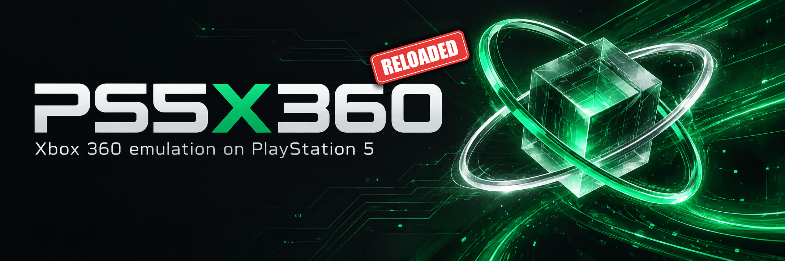
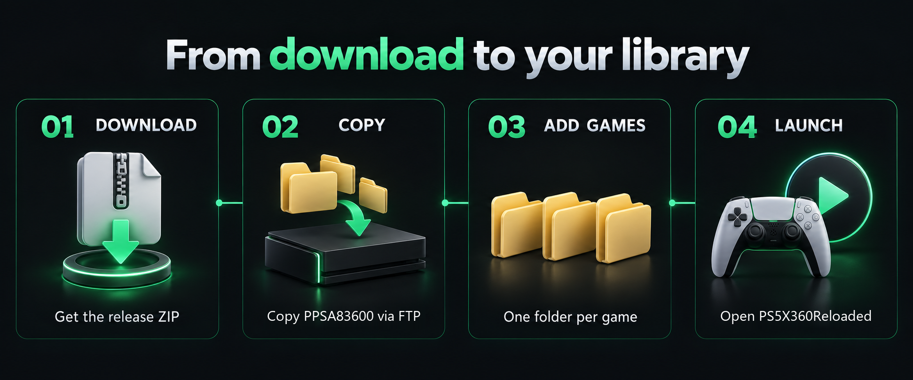

<p align="center">
  
</p>

<p align="center">
  <a href="https://github.com/grzegorz2047/PS5X360Reloaded/releases"><strong>Download the optimized build</strong></a> ·
  <a href="https://github.com/BrinooTk/PS5X360/releases">Official releases</a> ·
  <a href="docs/INSTALLATION.md">Installation guide</a> ·
  <a href="docs/GAME-CONTENT.md">DLC, updates and discs</a> ·
  <a href="docs/COMPATIBILITY.md">Compatibility</a>
</p>

# PS5X360 Reloaded

An **Xbox 360 emulator for PlayStation 5**, built on Xenia Canary with native DualSense input,
audio output and RADV Vulkan graphics.

This repository is a fork of [BrinooTk/PS5X360](https://github.com/BrinooTk/PS5X360). It adds
an **optimized build** of the official v1.0.2: performance and bug fixes, new settings, better
presets for some games, and translations of its new texts into every language. It also contains a **rebuild of v1.0.2 from
the published sources**, where fixes that cannot be done as a binary patch are made.

**Games run, but compatibility varies.** Expect crashes, visual errors and uneven performance in
some titles. There is no promise of full-library compatibility or 60 FPS.

## The optimized build

The C++ in this repository is older than the official v1.0.2 executable: it stops at
v0.5.7-fix.1. An `eboot.bin` built from it would lack online play, per-game FSI, frame
generation and Kinect. So the optimized build takes the **official v1.0.2 package** and patches
its `eboot.bin` in a reproducible way. The details are in
[tools/binary-release](tools/binary-release/README.md).

- **Base check.** The official zip and executable must have the exact SHA-256 values. Every
  patch also checks the bytes it replaces, so a different executable fails instead of being
  patched wrongly.
- **Re-signing.** The patched ELF is signed again as a fake-signed executable.
- **Package files.** Presets, game configs and game patches come from this repository. The texts
  this build changes (`assets/lang-overrides`) are merged into the official language files. The
  build also writes `RELEASE.json`, `MANIFEST.json` and `licenses/PS5X360-OPT-NOTICE.txt`.
  Everything else is the official package unchanged.
- **CI.** [release-binary.yml](.github/workflows/release-binary.yml) builds the package. A
  `v*-opt*` tag also publishes it as a release.

### What it changes

Most of these changes are not in a published release yet; see [Releases](#releases).

**Performance**
- **JIT:** removes the memory barriers around the PowerPC atomic instructions `lwarx`, `ldarx`,
  `stwcx.` and `stdcx.`.
- **Memory protection:** no `clock_gettime` system calls around every protection change.
- **Fault handler:** no 256-byte XMM register copy on every access fault.
- **Threads:** the GPU command thread gets its own CPU core.

**Caches and settings on image installs**
- **Image installs:** on `.ffpkg` and `.ffpfsc` installs, `/app0` is read-only and `/download0`
  holds only about 500 MiB.
- **Caches:** shader, module and utility caches go to `/data/homebrew/PPSA50011/cache`.
  - Before, Halo: Reach alone filled `/download0`, and other games then lost their shader caches.
- **Shader cache on exit:** the emulator waits up to 30 s instead of 1.5 s to save the shader
  cache, so large caches (30–50 MB) are saved completely.
- **Settings:** the FSI choice and the frame generation setting are saved in
  `/download0/xbox360ps5`.
  - This fixes an endless restart loop for games with FSI on.
  - It also fixes frame generation, which could not be turned on.

**Background shaders (async shaders)**
- **On:** a draw waits for its real shader only when the placeholder would be visible:
  - a full-screen pass or a small target (up to 256 px) that overwrites the main render target;
  - for example, reflection cubes and the HDR luminance chain.

  This removes the purple surfaces and the purple reflection cube in Battlefield: Bad Company on
  a first run. Pipelines that are waited for are compiled first.
- **On (experimental):** a new third choice.
  - Only full-screen passes without depth test wait.
  - A placeholder with a colour output writes no colour or depth. An unfinished object is briefly
    missing (grey surfaces or a black sky) instead of being drawn as a purple patch.
  - In Battlefield: Bad Company with an empty cache, the worst 30 s raised from 0.2–0.6 to 43 FPS.

**Display**
- **VSync:** caps the game at about 60 frames per second. Games with a 60 FPS patch no longer run
  too fast (Battlefield: Bad Company ran at 80+ FPS). VSync off means no cap.
- **"No new frames" banner:** appears after 2 s instead of 45 s, and says that shaders may be
  compiling.

**Per-game settings**
- **FSI (per game):** a new setting on the Performance page (Off / Standard / On).
  - Standard keeps the game's preset, or else the global switch.
  - The change applies at the next launch; the emulator restarts by itself.

**Presets**
- **Battlefield: Bad Company:** FSI off, readback off, 6 shader threads. Shaders compile three
  times faster, and the game holds 60 FPS.
- **Fable III:** a faster preset, a game config, and optional game patches. The patches are off by
  default: 60 FPS, no MSAA, 576p/544p, and no motion blur, depth of field, bloom or glare.
- **Fable II:** back to the official preset. The faster preset made the game ignore the
  controller, because of `fast_locks`.

**Translations**
- The texts this build changes or adds are translated into all 15 language files.
- A check in CI makes sure every language file has all of these texts, in the loader's format.

Not included, because tests showed they made things worse: skipping placeholder draws, and a
"no waiting" background-shader mode. Both left purple surfaces or a purple sky.

### Releases

| Release | Contents |
| --- | --- |
| [v1.0.2-opt-r2](https://github.com/grzegorz2047/PS5X360Reloaded/releases/tag/v1.0.2-opt-r2) (latest) | Patch groups 1–5 (JIT, memory protection, fault handler, threads, FSI files on image installs), checked in its `eboot.bin`; the Fable III preset and patches; a faster Fable II preset |
| Not released yet: test builds (CI artifacts of `fix/mmio-gpr-and-ci`), not a release | Everything else above: cache folder, shader-cache exit, background shader modes, VSync cap, frame generation setting, banner, FSI per game, Bad Company preset, Fable II preset back to official, translations, the notice file |

In v1.0.2-opt-r2, Fable II ignores the controller. To fix it, set **fast locks** to Off in that
game's settings.

Each release has these files:
- `PPSA50011.zip`: extract it and copy the `PPSA50011` folder to `/data/homebrew/` (see
  [Quick installation](#quick-installation)).
- `PPSA50011.ffpkg`: a UFS2 image, mounted by ShadowMountPlus.
- `PPSA50011.ffpfsc`: a compressed PFS image, mounted by ShadowMountPlus.
- The Fable III patch file (also inside the packages). Builds from `release-binary.yml` add
  checksum files.

With an image, the package is read-only. Put the games on another drive and add the folder in
**Settings → Game folders**.

Before you replace an image, close the emulator. If a game hung on exit, restart the console
first: the old image can stay mounted until then.

The Helper (see [Official v1.0.2](#official-v102-upstream)) updates from the official releases
page, so it may replace an optimized build with the official one (not checked).

## Game status on the console

These results were measured on a PS5 with the official v1.0.2 executable plus this fork's binary
patches (some not released yet), or with a source test build where a row says so. FPS values
come from the emulator's own logs: its 30 s performance windows and its 5 s performance sampler.

| Game | Status | What helps / known cause |
| --- | --- | --- |
| Fable II | 30 FPS (the game's own cap) | In the game's settings, turn `memory_boost` and `fast_dot` on and `fast_locks`, `readback` and `clear_pages` off. That raised 26.4 to 30.0 FPS at the same spot. `fast_locks` on makes the game ignore the controller; `readback` off breaks the make-up screen. |
| Fable III | about 22–24 FPS | Fork preset. The GPU command thread is about 80 % busy, and two game threads about 85 %. |
| Battlefield: Bad Company | 60 FPS after the first shader compile | With the game's 60 FPS patch, the fork preset (FSI off) and the VSync cap; the preset and the cap are not released yet. |
| Battlefield 3 | hangs when the campaign level starts | Source fix 20 gets the loading past the reused-handle wait. Then the GPU waits for a render job that never runs. The game's vertex shader writes the job's thread mask through `memexport`, and the emulator did not read that small write back into memory, so the job stayed runnable by no thread. Source fix 30 reads such writes back (`1.0.3_candidate_25`, not tested on the console yet). The official v1.0.2 hangs even earlier. |
| Call of Duty: Modern Warfare 2 | about 20 FPS | No thread is saturated. `memexport` off gives 2–3 FPS more, but parts of the picture go missing. |
| Call of Duty: Black Ops | 18.6–18.8 FPS | Limited by the game's own threads. None of the settings tried change it. |
| Call of Duty: Black Ops II | about 16 FPS | Limited by the game's own threads; the GPU thread is idle about 70 % of the time. |
| Call of Duty: Black Ops III | starts; asks for an Xbox Live sign-in | The log shows it cannot reach the API server. The **Online** network mode may help (not confirmed). Source fix 22 adds a network switch to the in-game guide (`1.0.3_candidate_3`, not tested on the console yet). |
| Minecraft: Xbox 360 Edition | menus 35–56 FPS, in the world about 1.2 FPS | Not caused by the network: offline is the same. The main suspect, not yet tested on the console, is many threads waiting on the same objects, which slows the emulator's wake-up path. |
| Handball 16 | reaches the title screen; START does nothing | Source fix 26 makes it start: the disc's Windows-1252 file names (such as `café`) broke the mount, which showed a misleading "Not enough space". After the save-drive prompt the save worker stops on a `DeleteFile("")` the emulator rejected, so the title screen waits forever. The fix is in `1.0.3_candidate_26` (not tested on the console yet). |
| Naruto: The Broken Bond | starts; reaches the save prompt at about 28 FPS | Source fix 28: the emulator sent a sign-in notification before the game had created the object that handles it. Confirmed on the console with `1.0.3_candidate_23`. |
| GTA IV | about 45–59 FPS | One short session, with frame generation (automatic), `fast_locks` and `memory_boost` on. |
| Halo: Reach | not measured | Its cache used to fill `/download0`. The cache folder change (not released yet) is meant to fix that; not tested with this game. |

## Rebuilding v1.0.2 from source

Fixes that cannot be written as a binary patch are made in a rebuild of v1.0.2 from the
author's published source drops. These sources are reconstructed, not the original:

- **Core:** reproducible. It is Xenia Canary netplay `d2cf527aa` plus the diffs from the 1.0.0
  and 1.0.2 drops.
- **Launcher, home screen and platform layer:** reconstructed from the newest published version
  of each file. Headers that were never published are rewritten in
  `tools/source-1.0.2/reconstructed/`.
- **Missing:** the OpenGL renderer (the build is Vulkan only), disc-drive games and the USB Kinect.
- **Not byte-identical** with the official executable, and it cannot be.
- **Licence:** the executable links wolfSSL and ps5-framegen, so as a whole it is GPL-3.0.
  Anyone who distributes it must include the complete source.

The first rebuild ran the launcher, Modern Warfare 2, Black Ops and Dragon Age II on the console
like the official build. The rebuild with the ported fixes has not been tested on a console as a
whole yet: only single candidates were, for one game each. **These builds are for testing, not
for release.**

| Branch | Contents |
| --- | --- |
| [`source-1.0.2`](https://github.com/grzegorz2047/PS5X360Reloaded/tree/source-1.0.2) | The rebuilt tree: assembly scripts, reconstructed files and the dark theme |
| [`source-1.0.2-patches`](https://github.com/grzegorz2047/PS5X360Reloaded/tree/source-1.0.2-patches) | The optimized build's patches rewritten as source (fixes 01–13), plus fixes 20, 22–25 and 30. Fixes 28 and 29 are being merged. |
| [`source-1.0.2-forward`](https://github.com/grzegorz2047/PS5X360Reloaded/tree/source-1.0.2-forward) | Fix 21: home screen forwarders, launched straight into a game (not merged yet) |
| [`fix/naruto-start`](https://github.com/grzegorz2047/PS5X360Reloaded/tree/fix/naruto-start) | Fixes 28 and 29 (Naruto) |
| [`fix/handball16-disc-mount`](https://github.com/grzegorz2047/PS5X360Reloaded/tree/fix/handball16-disc-mount) | Fix 26 (Handball 16), not merged yet |
| [`fix/save-device-choice`](https://github.com/grzegorz2047/PS5X360Reloaded/tree/fix/save-device-choice) | Fix 27 (save drive choice), not merged yet |

The full description is in
[docs/SOURCE-1.0.2.md](https://github.com/grzegorz2047/PS5X360Reloaded/blob/source-1.0.2-patches/docs/SOURCE-1.0.2.md).
The fixes are listed in
[tools/source-1.0.2/fixes](https://github.com/grzegorz2047/PS5X360Reloaded/tree/source-1.0.2-patches/tools/source-1.0.2/fixes).

| Fix | What it does | Host tests |
| --- | --- | --- |
| 01–13 | The optimized build's binary patches, as source | None for the source version; the binary patches are tested on `ci/binary-patch-tests` |
| 20 | Re-creates kernel objects behind stale handles. A thread that has exited gets a signalled stand-in (Battlefield 3). | `check-stale-dispatch-header.cpp` |
| 21 | Starts one game straight from a home screen forwarder: `--rom <game>` and `--exit-after-game` | `check-forward.cpp` |
| 22 | The guide's network row switches Off / System Link / Online while a game runs | `check-guide-network.cpp` |
| 23 | Text missing from a language falls back to English instead of Portuguese | `check-english-fallback.cpp` |
| 24 | Diagnostics: the STALL report names what each thread and the GPU wait for, including the owner of a GPU label wait | `check-stall-dump.cpp` |
| 25 | English is the interface's source language: the code's text keys are English, not Portuguese | `check-english-source.py` |
| 26 | Disc file names in Windows-1252 (such as `café`) are converted properly, and `DeleteFile("")` is answered at once (Handball 16) | `check-gdfx-names.cpp` |
| 27 | When a game asks where to save, every usable drive is offered (internal, USB, the M.2 extended storage), and a default can be set | `check-save-devices.cpp`, `check-save-storage.cpp` |
| 28 | A notification listener gets the start-up sign-in change only after its first poll (Naruto: The Broken Bond) | `check-notify-first-poll.cpp` |
| 29 | `network.conf` is written even when its folder is missing | in `run-fix-checks.sh` |
| 30 | Small `memexport` writes from the GPU are read back into memory, merging only the changed dwords (Battlefield 3) | `check-memexport-merge.cpp` |

**Building:**
- In GitHub Actions: `gh workflow run build-source-1.0.2.yml --repo grzegorz2047/PS5X360Reloaded --ref source-1.0.2-patches`.
  - The artifact is `eboot-1.0.2-from-source-NOT-FOR-RELEASE`, with `eboot.bin`, `eboot.elf`,
    `SOURCES.json` and the build log.
- Locally: `tools/source-1.0.2/assemble.py`, then `tools/source-1.0.2/build.sh`. See the
  document above.

**Test builds** are labelled on the home screen as **PS5X360 v1.0.3_candidate_N**, so you can
see which build is running. The label comes from `tools/source-1.0.2/BUILD_VERSION`.

| Candidate | Contents |
| --- | --- |
| `_1` | fix 20 (first version) |
| `_2` | fix 20 with the exited-thread stand-in |
| `_3` | fixes 22 and 23 |
| `_4` | fix 21 (forwarders) |
| `_5`–`_22` | diagnostics and fixes for Battlefield 3, Handball 16 and the save drive choice; `_11` added fix 25 (English) |
| `_23` | fix 28 (Naruto), confirmed on the console |
| `_24` | fix 27, first version: crashed the emulator while checking drives (replaced) |
| `_25` | fix 30 (Battlefield 3) |
| `_26` | fix 26 with the `DeleteFile("")` change (Handball 16) |
| `_27` | fix 27 with drive checks that cannot crash |

Diagnostic candidates only add logging; they are not meant to fix anything.

## Tests and CI

| Workflow | Branch | What it checks |
| --- | --- | --- |
| Optimized PS5 package (`release-binary.yml`) | `fix/mmio-gpr-and-ci` | Every language has the same changed UI texts, in the loader's format (`tools/check-lang-overrides.py`), then builds the package and the images |
| Tests (`tests.yml`) | `ci/binary-patch-tests` | Applies every binary patch to the official executable, checks branches and unwind data, and runs the patches' new code (code caves) in an emulator (Unicorn). Also runs the repository's host tests (AutoLog server, Content Installer, deploy and inspection tools). |
| Source checks (`source-checks.yml`) | `ci/binary-patch-tests` | Runs the `tools/check-*` programs against the rebuilt v1.0.2 tree. The 16 checks that apply to it must pass. |
| Host checks of the 1.0.2 source fixes (`source-fix-checks.yml`) | `source-1.0.2-patches` and the `fix/*` branches | Tests for fixes 20 and 22–30, run by `tools/source-1.0.2/run-fix-checks.sh` |
| Source 1.0.2 fix checks (`source-1.0.2-fix-checks.yml`) | `source-1.0.2-forward` | Tests for fix 21, built with AddressSanitizer and UndefinedBehaviorSanitizer |
| Rebuild v1.0.2 from source drops (`build-source-1.0.2.yml`) | `source-1.0.2`, `source-1.0.2-patches`, `source-1.0.2-forward` (a copy on `main` provides the dispatch button) | Builds the executable. On the two fix branches it first runs that branch's fix checks. |

Fixes 20–30 have host tests of their logic. The binary patches are tested on
`ci/binary-patch-tests`, which the release workflow does not run yet. What only the console can
show is listed for each fix in `tools/source-1.0.2/fixes/README.md`.

## What PS5X360 includes (upstream features)

- A home screen and cover library for extracted games (XEX), ISO images and GOD/STFS packages,
  with folders and filters.
- **DLC and title updates**, installed from the game's sheet or automatically when you press Play.
  **Games with several discs** are supported. See [DLC, updates and discs](docs/GAME-CONTENT.md).
- Per-game settings and community Xenia Canary patches, matched to the game's executable version.
- Player profiles for up to four local players, saved games and achievements with notifications.
- An in-game guide, opened with the touchpad: resume, the library over the running game, and
  settings.
- Frame generation (FSR3, experimental), FPS display, CAS sharpening and FSR upscaling.
- Kinect with a phone or a USB Kinect (experimental), and settings from a phone or computer.
- Online play through Xenia netplay, and System Link (experimental). Use the game's Xbox LIVE
  menu; System Link only finds games on your home network.
- Covers from XboxUnity and Microsoft's image server.
- An interface in **16 languages**, following the PS5 language: Portuguese (Brazil), English,
  German, Spanish (Spain and Latin America), French, Italian, Japanese, Korean, Dutch, Polish,
  Portuguese (Portugal), Russian, Turkish and Chinese (Simplified and Traditional).
- Per-game log files, downloadable as a ZIP.

## Official v1.0.2 (upstream)

- **Online play (experimental) works on the PS5:** requests no longer hang, Modern Warfare 2
  searches Xbox LIVE matches, and router port requests use the ports the PS5 really uses.
- **PS5X360 Content Installer** for Windows installs DLC and title updates over the network. See
  [tools/content-installer](tools/content-installer/README.md).
- **Helper 1.3.0** (autoload ELF) updates PS5X360 from the official releases page, in the
  console's language. It also sends game logs to the official build's developer, as the old Tool
  did.
- **All 16 languages** have the home screen texts, and there is a **dark theme** (Settings →
  Theme).

The full notes are in [docs/releases/v1.0.2.md](docs/releases/v1.0.2.md). The v1.0.0 changes
(new home screen, system windows, Canary e6cd2e4 core, about 220 game presets) are in the
[changelog](CHANGELOG.md).

Known problems upstream:
- Need for Speed Most Wanted (2012) stops when driving starts.
- Xbox avatars are not drawn.
- Kinect is experimental.

## Quick installation



1. Download `PPSA50011.zip` from the [optimized build's releases](https://github.com/grzegorz2047/PS5X360Reloaded/releases)
   or the [official releases](https://github.com/BrinooTk/PS5X360/releases).
2. Extract it on your computer.
3. Using FTP, copy the complete `PPSA50011` folder to **`/data/homebrew/PPSA50011`** on your PS5.
   - When updating, keep your games, saves (`saves/`) and logs.
4. Let ShadowMountPlus register the title, then open **PS5X360** from the PS5 home screen.
5. Put each game in its own folder under `PPSA50011/assets/roms/`, or in a folder added in
   **Settings → Game folders**. Reopen the emulator or select **Settings → Refresh game list**.

The development setup uses **PS5 firmware 13.60 with homebrew access, etaHEN, ShadowMountPlus
and kstuff**. Other setups have not been verified. You need an already working homebrew
environment.

[Read the full installation and usage guide →](docs/INSTALLATION.md)

## Organize your games

```text
PPSA50011/
├── eboot.bin
├── sce_module/
├── sce_sys/
└── assets/
    └── roms/
        ├── Game One/
        │   ├── default.xex
        │   └── ...game data...
        ├── Game Two/
        │   └── game.iso
        └── Game Three/
            ├── ...GOD or STFS package...
            └── ...matching .data folder, if required...
```

Keep all extracted game data together. Use **Settings → Game folders** to add more locations,
including external drives. See the
[folder configuration guide](docs/INSTALLATION.md#multiple-locations-and-external-devices-development-v030-preview).

**No games, console BIOS or keys are included.**

## Controls

| DualSense button | Home | Library |
| --- | --- | --- |
| D-pad / stick up and down | Change channel | — |
| D-pad / stick left and right | Choose a slot | Choose a game |
| Cross | Open | Open the game's sheet (Play, Patches, Settings, Achievements, DLCs, Updates) |
| Triangle | — | The game's settings |
| Square | Settings | Settings |
| L1 / R1 | — | Change library filter |
| Circle | — | Back to the home |
| Touchpad, during a game | Open the emulator guide | |

The guide offers resume, the library over the running game, settings, Xbox BACK and exit. To use
the touchpad as Xbox BACK instead, change **Settings → Touchpad click**; the guide then opens with
**OPTIONS + touchpad**.

## Compatibility and bug reports

Booting into a menu is not the same as completing gameplay. Some titles still fail during scenes
or fights. The [compatibility notes](docs/COMPATIBILITY.md) separate what was seen on a console
from host tests.

When you report a bug, include:
- the game, title ID, region and version;
- the enabled patches;
- the firmware and the emulator version (the home screen shows it);
- the exact point where the game fails;
- a short video or screenshot, if you can;
- the matching game-session logs.

Logs are in `PPSA50011/logs`. If that folder cannot be written, they go to the sandbox folder
`download0/xbox360ps5/LOGS`. The included log downloader can create a ZIP to share.

- **Official build:** report problems on [BrinooTk/PS5X360](https://github.com/BrinooTk/PS5X360/issues).
- **Optimized build:** report problems on this fork.

## Development

- **Official v1.0.2:** the core is Xenia Canary e6cd2e4 with Xenia Canary netplay (AdrianCassar,
  `netplay_canary_experimental` d2cf527aa). Its PS5 changes are published with each release as
  `PS5X360-source-1.0.2-changes.zip`.
- **This repository's C++:** at v0.5.7-fix.1, with the earlier core changes in
  `patches/canary/xbox360ps5.patch`.
- **New fixes:** made in [tools/binary-release](tools/binary-release/README.md) as binary patches,
  or on the source rebuild branches (see above).

Further reading: [Build notes and source dependencies](docs/BUILD.md) ·
[Third-party credits](docs/CREDITS.md) · [Release guide (official builds)](docs/RELEASING.md)

## Support the projects

To support the original author, BrinooTk, you can contribute through
[Ko-fi](https://ko-fi.com/brinoblitz). Testing, bug reports and sharing the project also help.

Older M0–M8 milestones and Portuguese research notes are preserved in
[the port history](docs/PORT_HISTORY_PT.md). They describe earlier stages and do not replace the
current status.

## Credits and licenses

Based on [PS5X360](https://github.com/BrinooTk/PS5X360) by BrinooTk and on
[Xenia Canary](https://github.com/xenia-canary/xenia-canary).

Other components:
- the [PS5_Vulkan](https://github.com/mihawk-99/PS5_Vulkan) RADV work, and the native runtime and
  tooling from the projects listed in [Credits](docs/CREDITS.md);
- online play from [Xenia Canary netplay](https://github.com/AdrianCassar/xenia-canary) by
  AdrianCassar, with libcurl, wolfSSL and miniupnpc;
- frame generation from [ps5-framegen](https://github.com/Swordpdf/ps5-framegen) by Swordpdf;
- community patches from [xenia-canary/game-patches](https://github.com/xenia-canary/game-patches);
- covers from XboxUnity and Microsoft's image server.

Licenses:
- Original project code is licensed under MIT.
- Bundled third-party components keep their own licenses, including BSD, LGPL and GPL.
- See [LICENSE](LICENSE), [licenses/](licenses/) and the font's
  [SIL Open Font License](assets/fonts/OFL.txt).
- The complete set of licenses is in the release package's `PPSA50011/licenses/` folder.
- The executable (official and optimized alike) links wolfSSL and ps5-framegen, so as a whole it
  is GPL-3.0. Its source is the author's published source drops, plus
  [tools/binary-release](tools/binary-release/README.md) for the optimized build's changes.
- Packages built by `release-binary.yml` add `licenses/PS5X360-OPT-NOTICE.txt`, which lists what
  they change and where the source is. v1.0.2-opt-r2 predates it.

PS5X360 is an independent community project and is not affiliated with Sony or Microsoft. The
README artwork is illustrative branding, not an emulator screenshot.

## Automatic diagnostic reports

The optional **AutoLog ELF preview** reads game logs on the PS5 and sends them to the developer
of the official build, without a PC. It is attached to earlier official releases and is loaded
separately once per console boot.
- **Before enabling it:** read the [reporting notice and instructions](native/autolog/README.md).
  That page also covers how to opt out, and the limits.
- **Optional PC fallback:** see [AutoLog setup](docs/AUTOLOG.md).
- **Source and license:** included under `PPSA50011/licenses/`.
